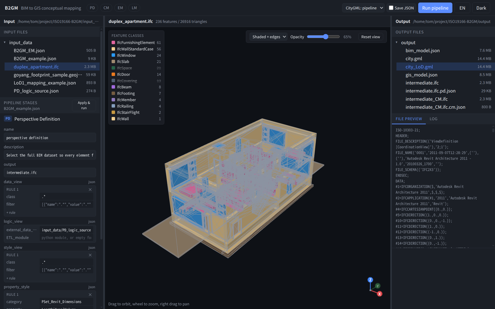
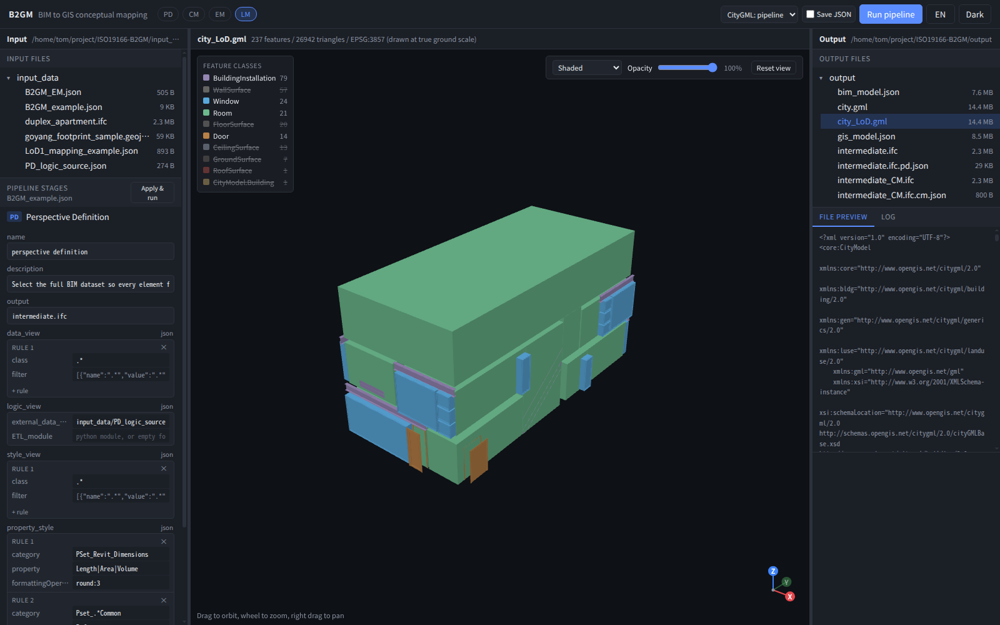

# ISO 19166 B2GM — BIM to GIS conceptual Mapping Tool

[](https://github.com/mac999/ISO19166-B2GM/actions/workflows/tests.yml)

Written by the project leader of ISO/TS 19166. This is a personal
implementation, not an official ISO or ISO/TC 211 deliverable and not a
conformance certification.

An implementation of the [ISO/TS 19166 B2GM](https://www.iso.org/standard/90943.html) conceptual framework: mapping a BIM model (IFC) into a GIS model (CityGML) through four well-defined stages. In fact, I thought there were issues with practical application because standards like ISO often only have standard documents without providing tools. Taking this into consideration, I plan to continue updating it whenever I have time. 

<p align="center">
 </img>
</p>

If you are interested in this project, please fork and join.

```
 IFC (BIM)  ──►  PD  ──►  CM  ──►  EM  ──►  LM  ──►  CityGML (GIS)
                 │        │        │        │
        Perspective  Coordinate  Element    LoD
        Definition   Mapping     Mapping    Mapping
```

| Stage | Name                    | Purpose                                                        |
|-------|-------------------------|----------------------------------------------------------------|
| PD    | Perspective Definition  | Select the required subset of the BIM dataset (data/logic/style views) |
| CM    | Coordinate Mapping      | Transform source CRS → destination CRS (e.g. EPSG:4326 → EPSG:3857) |
| EM    | Element Mapping         | Map an IFC class to its GIS/CityGML class (e.g. `IfcBuilding` → `CityModel.Building`) |
| LM    | LoD Mapping             | Assign a GIS Level-of-Detail (LOD0…LOD4)                        |


<p align="center">
 </img>  </br>
 </img>
 </img>  </br>
 </img> </br>
 </img> 
</p>

The pipeline also ships with a browser workspace: the input tree and the
PD/CM/EM/LM stage properties on the left, a WebGL canvas in the middle and the
output tree on the right. Drop an IFC on the canvas to convert it, or edit a
stage rule and run it again. Clicking a class in the legend hides it, which is
how you look inside the result. See [Web view](doc/web-view.md).

<p align="center">
  </img>
  </br>
  </img>
</p>

## Quick start

```bash
git clone https://github.com/mac999/ISO19166-B2GM.git
cd ISO19166-B2GM
pip install -r requirements.txt
python B2GM_main.py                           # CityGML 2.0 from the bundled sample
python B2GM_main.py --citygml-version 3.0     # CityGML 3.0
python B2GM_main.py --web                     # browser workspace on localhost
python -m pytest
```

Results land under `output/`. Python 3.10 to 3.13 are exercised in CI; the
sample is IFC2X3 and the test suite also runs an IFC4 model through every stage.
A live copy of the web view runs at https://iso19166-b2gm-mac999.fly.dev.

## Scope

What this implementation does, stated so it can be checked:

- Every stage is driven by rules in a JSON config, and the rule vocabulary
  follows the standard's UML: `PD_data_view` / `PD_logic_view` /
  `PD_property_style`, `EM_rule.PSet_operation`, `LM_rule` operator chains.
  Changing the config changes the output; nothing is hard-coded per IFC type.
- All eleven ISO 19166 Table 8 LoD operators are implemented and callable from
  the pipeline config, not only from Python.
- The CM stage rewrites geometry into the destination CRS, so the output is
  georeferenced rather than sitting at the project origin.
- Output validates against the official OGC CityGML schemas, in 2.0 and in 3.0,
  and the version is a config or CLI variable.
- The conceptual model classes mirror the ISO 19166 XSDs, and
  `tests/test_xsd_conformance.py` parses those XSDs to check it, so a renamed or
  missing member fails the build.
- Core dependencies are ifcopenshell, pyproj, shapely, numpy and tqdm. MIT.

What it is **not**:

- Not a general IFC to CityGML data translator. It implements the ISO 19166
  conceptual mapping stages; geometry handling is deliberately simple.
- Not a conformance test suite. The XSD check verifies this implementation, not
  a third party's.
- Geometry is triangulated B-rep. A mesh is written as `gml:Solid` only when it
  actually closes, otherwise as `gml:MultiSurface`.
- Boolean operators work on 2D geometry, or on 3D via `manifold3d` when
  installed; without it 3D booleans are limited to vertical prisms.

## Documentation

| Page | Contents |
|------|----------|
| [Install and run](doc/install-and-run.md) | package install, console commands, launcher scripts, CLI options, choosing CityGML 2.0 or 3.0, output document structure |
| [Pipeline configuration](doc/pipeline-configuration.md) | stage rules, full-element mapping, coordinate mapping and georeferencing, PD views, EM property-set operations, the LM geometry operators |
| [Architecture](doc/architecture.md) | module map, ISO 19166 XSD alignment, saving the conceptual models as JSON |
| [Web view](doc/web-view.md) | the browser workspace, upload and conversion, deploying to Fly.io |

## Tests

```bash
python -m pytest
```

The suite under `tests/` covers the conceptual model, every stage, the LM
operator chains, IFC parsing for IFC2X3 and IFC4, CityGML 2.0 and 3.0 document
structure and the end-to-end pipeline. It runs on GitHub Actions for each push
and pull request. Tests that need optional dependencies skip when those are
missing.

# Author
Taewook kang, Ph.D, laputa99999@gmail.com

Project leader, ISO/TC 211 ISO/TS 19166
