# ISO 19166 B2GM — BIM to GIS conceptual Mapping Tool

[](https://github.com/mac999/ISO19166-B2GM/actions/workflows/tests.yml)

An implementation of the [ISO/TS 19166 B2GM](https://www.iso.org/standard/90943.html)
conceptual framework: a BIM model (IFC) is mapped into a GIS model (CityGML)
through four rule-driven stages. The rules live in a JSON file whose vocabulary
follows the standard's UML, the output validates against the official OGC
CityGML 2.0 and 3.0 schemas, and a browser workspace shows the source, the
rules and the result side by side.

Written by the project leader of ISO/TS 19166. This is a personal
implementation, not an official ISO or ISO/TC 211 deliverable and not a
conformance certification. Standards such as this one usually ship as a document
without a tool, which makes them hard to try out; this repository is meant to
close that gap. If you are interested, fork and join.

<p align="center">
  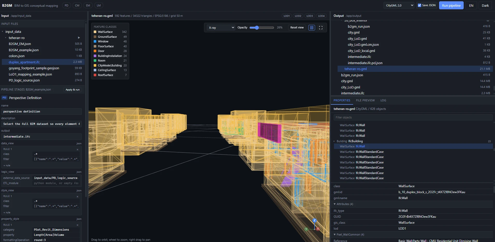</img>
</p>

## Contents

1. [How the mapping works](#how-the-mapping-works)
2. [Highlights](#highlights)
3. [Quick start](#quick-start)
4. [What comes out](#what-comes-out)
5. [Web view](#web-view)
6. [Configuring the mapping](#configuring-the-mapping)
7. [Scope](#scope)
8. [Documentation](#documentation)
9. [For developers](#for-developers)
10. [Revision history](#revision-history)
11. [Citation and author](#citation-and-author)

## How the mapping works

```
 IFC (BIM)  ──►  PD  ──►  CM  ──►  EM  ──►  LM  ──►  CityGML (GIS)
                 │        │        │        │
        Perspective  Coordinate  Element    LoD
        Definition   Mapping     Mapping    Mapping
```

| Stage | Name                    | Purpose                                                        |
|-------|-------------------------|----------------------------------------------------------------|
| PD    | Perspective Definition  | Select the required subset of the BIM dataset (data/logic/style views) |
| CM    | Coordinate Mapping      | Transform source CRS → destination CRS (e.g. EPSG:4326 → EPSG:3857) |
| EM    | Element Mapping         | Map an IFC class to its GIS/CityGML class (e.g. `IfcBuilding` → `CityModel.Building`) |
| LM    | LoD Mapping             | Assign a GIS Level-of-Detail (LOD0…LOD4) and regenerate the geometry with the Table 8 operators |

Each stage reads its rules from the pipeline file and writes an intermediate
file, so a run can be inspected stage by stage. The concept figures below are
from the standard's development.

<p align="center">
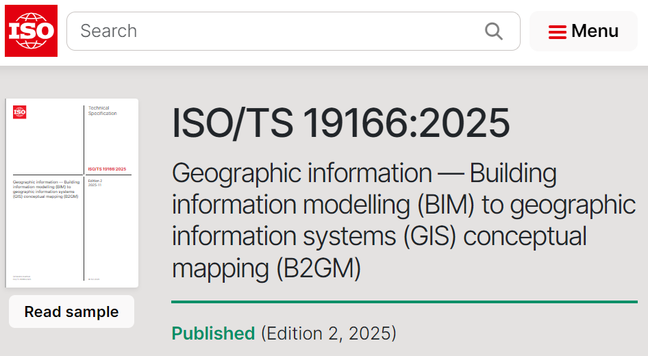</img> </br>
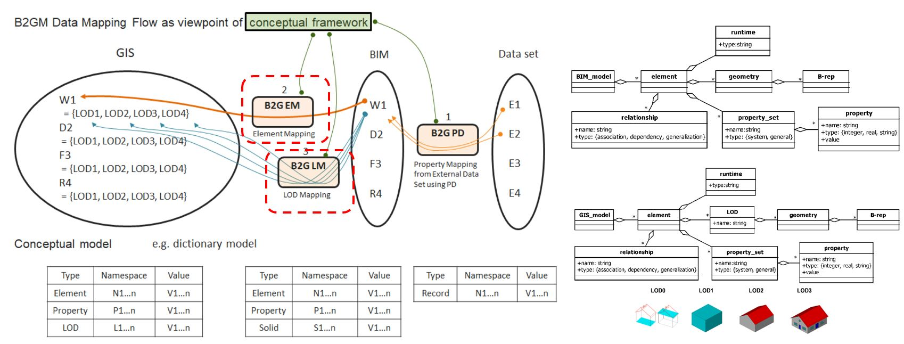 </img>  </br>
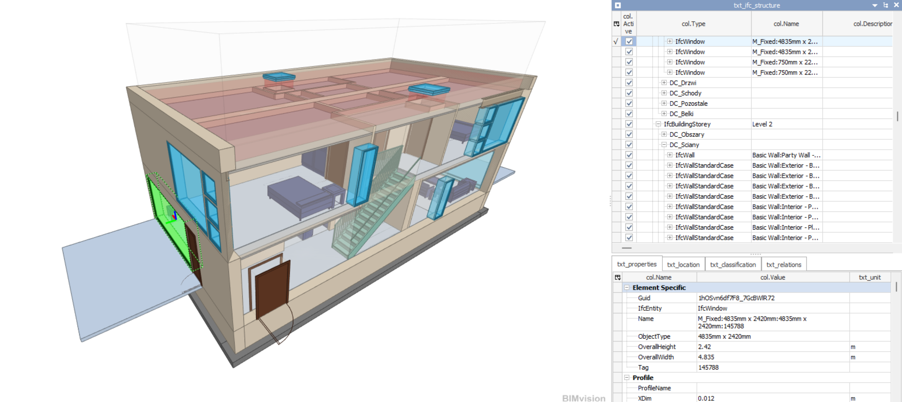 </img>
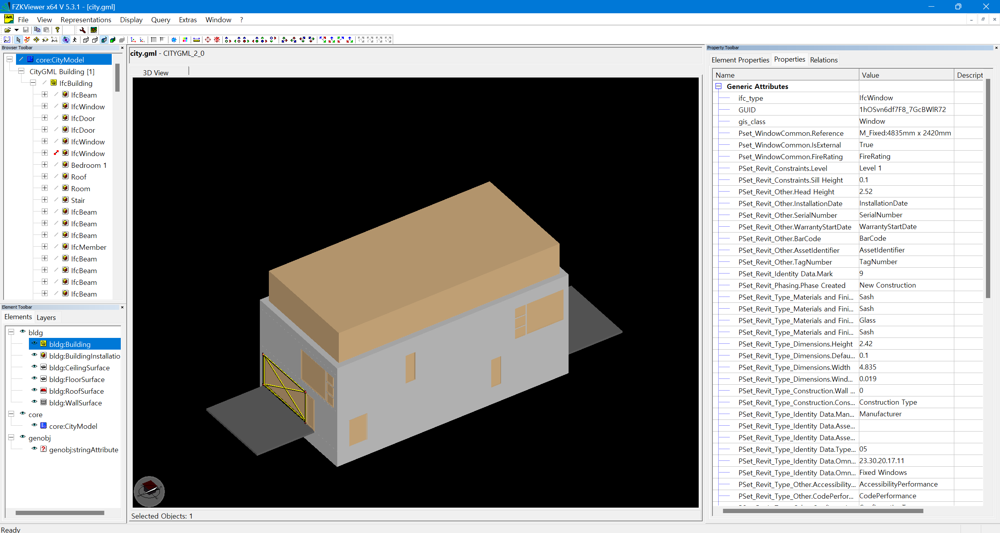 </img>  </br>
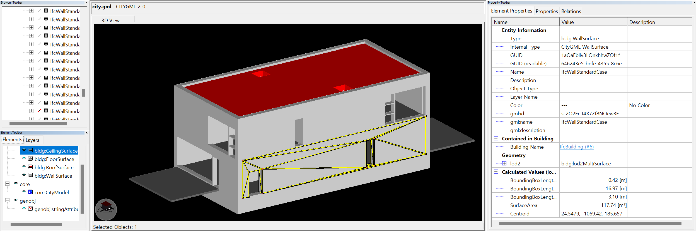 </img> </br>
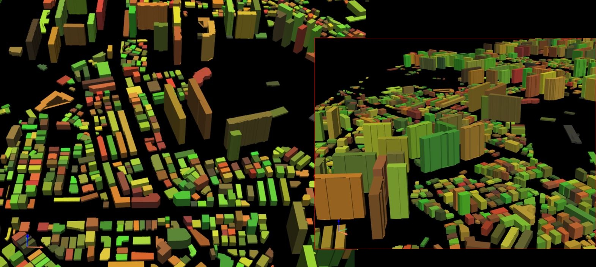 </img>
</p>

## Highlights

Batch conversion from BIM to GIS. The source IFC below is opened in x-ray with
its spatial structure listed under the output tree. A batch run applies one
pipeline per building folder under `input_data/teheran-ro` and writes each
result to a matching output folder with its own `b2gm_run.json` and final
CityGML. The second capture is the output folder opened as one scene: twenty
buildings along Teheran-ro in Seoul, mapped from LOD1 block to LOD4 interior
and placed in EPSG:5186 by the CM stage or by the IFC's own `IfcMapConversion`.

<p align="center">
  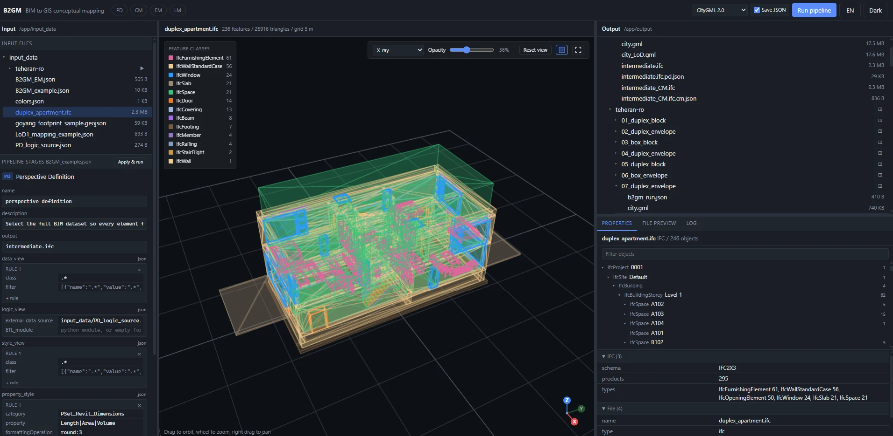</img>
</p>

<p align="center">
  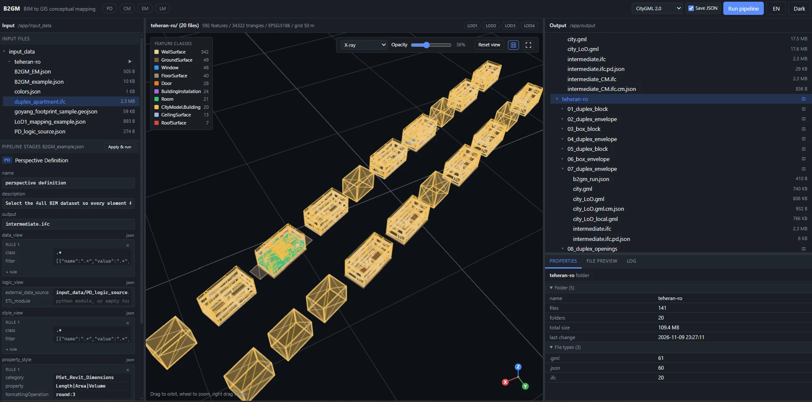</img>
</p>

An IFC opens as its spatial structure in the lower right panel. Picking an
object lists its attributes, relations and property sets and highlights it on
the canvas; here a kitchen space is picked with the model in x-ray.

<p align="center">
  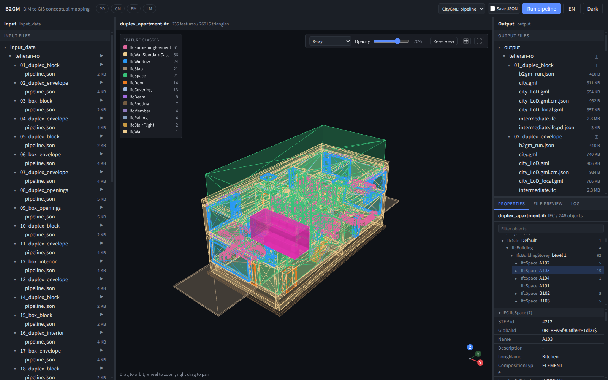</img>
</p>

A CityGML file opens as its feature tree, Building to boundary surfaces to
openings. A picked wall is highlighted with the windows it hosts, and its
generic attributes are grouped back into the IFC property sets they came from.

<p align="center">
  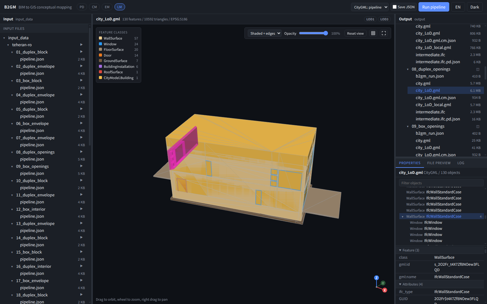</img>
</p>

## Quick start

Python 3.10 or newer. The core dependencies are ifcopenshell, pyproj, shapely,
numpy and tqdm.

```bash
git clone https://github.com/mac999/ISO19166-B2GM.git
cd ISO19166-B2GM
pip install -r requirements.txt
python B2GM_main.py                           # CityGML 2.0 from the bundled sample
python B2GM_main.py --citygml-version 3.0     # CityGML 3.0
python B2GM_main.py --web                     # browser workspace on localhost
python -m pytest
```

`pip install .` adds the `b2gm`, `b2gm-web`, `b2gm-em` and `b2gm-lm` console
commands; `run_pipeline.sh` / `.bat` and `run_web.sh` / `.bat` are launchers for
a clone. A live copy of the web view runs at
https://iso19166-b2gm-mac999.fly.dev, where you can drop your own IFC on the
canvas.

Optional packages switch on more: `manifold3d` for the 3D boolean operators,
`xmlschema` to validate the output against the OGC schemas, `xsdata` for the
typed CityGML writer.

## What comes out

With the bundled sample (`input_data/duplex_apartment.ifc`, IFC2X3) and the
example pipeline, `output/` receives:

| File | Stage | Contents |
|------|-------|----------|
| `intermediate.ifc` + `.pd.json` | PD | the selected elements and the perspective summary |
| `intermediate_CM.ifc` + `.cm.json` | CM | the model placed in the destination CRS; origin, true north and element count |
| `city.gml` | EM | CityGML with every element mapped to its feature class |
| `city_LoD.gml` | LM | the same with the LoD assigned and the operator geometry, for example a LOD1 block for the building and one for each room |
| `bim_model.json`, `gis_model.json` | with `--save-json` | the conceptual models in the shape of the ISO 19166 XSDs |

The CityGML version is a variable, not a build-time choice: `--citygml-version`
on the command line, `"citygml_version"` in the pipeline file, or the selector in
the web view. 3.0 keeps the building storeys as `bldg:Storey` features, which
2.0 has no element for, and writes closed meshes as `gml:Solid`.

## A district of buildings

`--input` also takes a folder of building folders, each holding the pipeline
that maps it, and merges the results into one city model with the `gml:id`s
kept unique. The shipped `input_data/teheran-ro` places twenty buildings along
Teheran-ro in Seoul, in EPSG:5186, two rows across the road with half a
building's frontage between neighbours, cycling through four profiles from a
LOD1 block to a LOD4 interior; one of them is placed by its own `IfcMapConversion`.
Positions are illustrative. See [Install and run](doc/install-and-run.md).

```bash
python B2GM_main.py --input input_data/teheran-ro --output-dir output/teheran-ro
```

## Web view

`python B2GM_main.py --web` opens a three-panel workspace on the stdlib HTTP
server, with no web framework and nothing to install beyond the core
dependencies.

- Left: the input tree and the pipeline stages. Scalars are plain fields; a
  rule set is a property grid per rule listing the keys the standard defines
  for that stage, with fixed choices such as `lod` and `PSet_operation` as
  drop-downs. **Apply & run** converts the selected IFC with the edited rules.
- Middle: a WebGL canvas. Drag to orbit, wheel to zoom, right-drag to pan; an
  axis gizmo snaps the view; six rendering modes (shaded, shaded + edges,
  wireframe, x-ray, flat + edges, hidden line); the legend hides a feature
  class on click, which is how you look inside a model; chips above the canvas
  do the same per level of detail. A file with nothing to draw shows its text
  here instead.
- Right: the output tree and, below it, three tabs. Properties shows an IFC's
  spatial structure or a CityGML file's feature tree with the attributes and
  property sets of the object picked in it, which is also highlighted on the
  canvas, through anything in front of it; a folder or any other file gets a
  metadata table, including the run record of a pipeline output folder. File
  preview and the stage log are the other two tabs.
- Colours per CityGML class and IFC type come from `input_data/colors.json`,
  so a project can restyle the view without touching the code.
- Header: the CityGML version, whether to save the JSON models, and the stage
  chips, which open a stage and show its output on the canvas. A folder in the
  input tree runs as a district and shows the merged model. Clicking a folder
  name in the output tree (the arrow folds it) reads every run below it one after another into one
  scene, each from the CityGML its run record names, so buildings placed by CM appear where
  CM put them. A progress strip shows the file being read, and Stop keeps
  what has landed.
- Canvas toolbar: rendering mode, opacity, reset view, a ground grid whose
  step is shown with the model stats, and a full-size view that hides the side
  panels (Esc restores them).

Drop an `.ifc` on the canvas, optionally with a pipeline `.json`, to convert it.
`?theme=`, `?lang=`, `?mode=`, `?opacity=`, `?select=`, `?folder=`, `?grid=1`, `?max=1` and `?hide=` preset a view
so it can be shared as a link. See [Web view](doc/web-view.md) for the routes and the
Fly.io deployment.

<p align="center">
  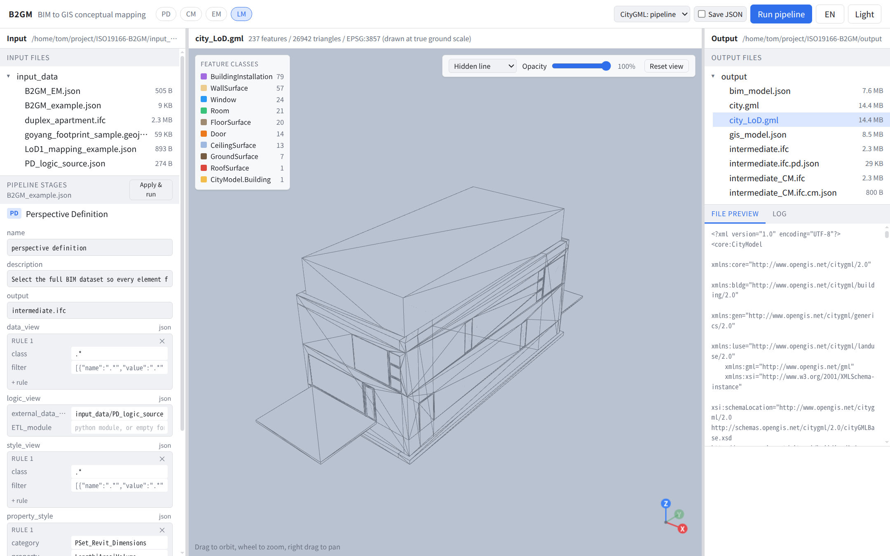</img>
</p>

## Configuring the mapping

`input_data/B2GM_example.json` defines the stage sequence. A stage carries its
`type`, an `output` name and its rules:

```json
{ "type": "EM", "output": "city.gml",
  "rule": [{ "source": "IfcBuilding", "destination": "CityModel.Building" }] }
```

```json
{ "type": "LM", "output": "city_LoD.gml",
  "rule": [{ "source": "IfcBuilding", "lod": "LOD1", "aggregate": "IfcWall.*",
             "operation": [{ "op": "footprint" },
                           { "op": "extrude", "args": { "height": { "$extent": "z" } } }] }] }
```

Patterns are full-match regular expressions. The PD stage carries data, logic
and style views and property formatting; CM carries the source and destination
CRS, an optional transform matrix and origin; EM carries the class mapping and
the `PSet_operation`; LM carries the LoD and an operator chain over the eleven
Table 8 operators. [Pipeline configuration](doc/pipeline-configuration.md)
covers every key.

## Scope

What this implementation does, stated so it can be checked:

- Every stage is driven by rules in a JSON config, and the rule vocabulary
  follows the standard's UML: `PD_data_view` / `PD_logic_view` /
  `PD_property_style`, `EM_rule.PSet_operation`, `LM_rule` operator chains.
  Changing the config changes the output; nothing is hard-coded per IFC type.
- All eleven ISO 19166 Table 8 LoD operators are implemented and callable from
  the pipeline config, not only from Python.
- The CM stage rewrites geometry into the destination CRS, so the output is
  georeferenced rather than sitting at the project origin. It reads
  `IfcMapConversion` / `IfcProjectedCRS` (and the IFC2x3 `ePSet_MapConversion`
  sets), else the `IfcSite` latitude and longitude with the site placement
  undone, and can run after LM so the operators work in the IFC's own metres.
- EM rules can filter on properties, so `Pset_WallCommon.IsExternal` separates
  `WallSurface` from `InteriorWallSurface` in the output.
- Output validates against the official OGC CityGML schemas, in 2.0 and in 3.0,
  and the version is a config or CLI variable.
- The conceptual model classes mirror the ISO 19166 XSDs, and
  `tests/test_xsd_conformance.py` parses those XSDs to check it, so a renamed or
  missing member fails the build.
- The parser reads every IfcProduct; which of them are mapped is the PD stage's
  decision. IFC2X3 and IFC4 input are both exercised by the test suite.

What it is **not**:

- Not a general IFC to CityGML data translator. It implements the ISO 19166
  conceptual mapping stages; geometry handling is deliberately simple.
- Not a conformance test suite. The XSD check verifies this implementation, not
  a third party's.
- CityGML output covers the Building and LandUse modules. Transportation,
  vegetation, relief and the other thematic modules are out of scope.
- Geometry is triangulated B-rep. A mesh is written as `gml:Solid` only when it
  actually closes, otherwise as `gml:MultiSurface`.
- Boolean operators work on 2D geometry, or on 3D via `manifold3d` when
  installed; without it 3D booleans are limited to vertical prisms.

## Documentation

| Page | Contents |
|------|----------|
| [Install and run](doc/install-and-run.md) | package install, console commands, launcher scripts, CLI options, choosing CityGML 2.0 or 3.0, output document structure |
| [Pipeline configuration](doc/pipeline-configuration.md) | stage rules, full-element mapping, coordinate mapping and georeferencing, PD views, EM property-set operations, the LM geometry operators |
| [Architecture](doc/architecture.md) | module map, ISO 19166 XSD alignment, saving the conceptual models as JSON |
| [Web view](doc/web-view.md) | the browser workspace, upload and conversion, deploying to Fly.io |

## For developers

| Module | Role |
|--------|------|
| `B2GM_main.py` | pipeline orchestrator and CLI |
| `B2GM_PD.py`, `B2GM_CM.py`, `B2GM_element.py`, `B2GM_LM.py` | the four stages |
| `B2GM_LM_operators.py` | the Table 8 operator library |
| `B2GM_BIM.py`, `B2GM_GIS.py`, `B2GM_citygml3.py` | IFC reader, CityGML 2.0 writer, CityGML 3.0 writer |
| `B2GM_model.py`, `B2GM_property.py` | the conceptual model mirroring the XSDs |
| `B2GM_web.py`, `web/` | the web view: HTTP routes, model readers, and the browser side |
| `XSD/`, `UML/` | the standard's schemas the model classes are checked against |

```bash
python -m pytest
```

The suite under `tests/` covers the conceptual model, every stage, the LM
operator chains, IFC parsing for IFC2X3 and IFC4, CityGML 2.0 and 3.0 document
structure, the web routes and the end-to-end pipeline. It runs on GitHub Actions
for every push and pull request on Python 3.10, 3.12 and 3.13. Tests that need
optional dependencies skip when those are missing.

Pull requests are welcome. Keep a change to one concern, add a test next to the
ones that cover that module, and run the suite before pushing.

## Revision history

The code is older than the repository: the stage modules carry a first-written
date of January 2024 and the GitHub history starts in January 2025. Releases
before 0.1.0 carried no number at the time; the 0.0.x numbers below are assigned
after the fact from the module headers and the commit history.

| Version | Date | Changes |
|---------|------|---------|
| 0.4.0 | 2026-11-10 | Object tree and properties below the output tree: IFC spatial structure with attributes, relations and property sets; CityGML features with their generic attributes grouped by property set and a geometry summary; metadata for folders and other files. A picked object is highlighted in the 3D view. Output folders open as one scene by clicking their name. |
| 0.3.3 | 2026-11-10 | Every run writes `b2gm_run.json` with its stage outputs and final CityGML. The folder view picks each building from it instead of the newest file, which failed on the server because the container image keeps file times to the second. |
| 0.3.2 | 2026-11-09 | The `teheran-ro` buildings stand in two rows across a 20 m road with half a frontage between neighbours instead of 130 m slots. The canvas gets a ground grid and a full-size view; `?grid=1` and `?max=1` preset them. `?lod=` holds until a folder load finishes. |
| 0.3.1 | 2026-11-09 | A folder in the output tree opens as one scene: each run's newest CityGML is read in turn, in its own coordinates, so a district can be checked building by building without the merged file. A progress strip under the canvas shows which file is loading, and Stop keeps what has been read. `?folder=` presets it. |
| 0.3.0 | 2026-11-09 | `--input` takes a folder of building folders, each with its own pipeline; the results are merged into one city model with unique `gml:id`s. CM rules take a `rotation`. The shipped `teheran-ro` district: twenty buildings along Teheran-ro in EPSG:5186 across four LoD profiles, one placed by its own `IfcMapConversion`. The web view runs a folder from the input tree. |
| 0.2.6 | 2026-11-08 | Georeferencing from `IfcMapConversion` + `IfcProjectedCRS` and the IFC2x3 `ePSet_MapConversion` sets, with lengths scaled from the project unit; a non-identity `IfcSite` placement is undone before projecting. The CM stage can run after LM and then writes the final CityGML, so the operators work in local metres. EM rules take PD-style property filters; the example maps interior walls to `InteriorWallSurface`, which both writers now place as a boundary surface. |
| 0.2.5 | 2026-11-08 | The saved BIM and GIS model JSON carry the destination CRS as `srsName`, and the viewer reads it, so a Web Mercator model no longer looks squashed next to the CityGML written from the same objects. |
| 0.2.4 | 2026-11-08 | Run pipeline writes under `output/<model>/` like a drop or Apply & run, re-runs overwrite that folder, and the result is shown and marked in the output tree straight away. |
| 0.2.3 | 2026-11-08 | LoD chips above the canvas filter a CityGML model by level, and `?lod=` presets them. The opacity slider runs to 0 and x-ray edges follow it. |
| 0.2.2 | 2026-11-08 | Saturated class palette, configurable from `input_data/colors.json`. Edges and wireframes drawn in the class colour. `?opacity=` and `?select=` reach the input tree. README opens on the source IFC drawn translucent; revision history traced back to the 2024 sources. |
| 0.2.1 | 2026-11-08 | The IFC parser reads every product instead of a fixed type list, so furniture, footings, the roof and stair flights now reach the PD stage; the example maps them. Openings whose host has no geometry of its own (skylights in an IfcRoof aggregate) are kept as installations instead of being lost. Files without geometry open as text in the middle panel. X-ray, flat + edges and hidden line rendering. `?select=` and `?opacity=` preset a view. README reorganised with current screenshots. |
| 0.2.0 | 2026-11-08 | Web view reworked: right-drag pan follows the pointer and orbits around the panned centre, two-sided lighting, axis gizmo with snap views, shaded / edges / wireframe modes, rule sets edited as property grids with the standard's keys, CityGML version and JSON save in the header, pipeline choice from the input tree, stage chips open their stage and show its output, themed scrollbars. IFC4 input covered by a fixture and regression test. GitHub Actions runs the suite on Python 3.10, 3.12 and 3.13; the package requires 3.10 or newer, which is the oldest ifcopenshell ships wheels for. README split into doc pages behind a quick start. |
| 0.1.x | 2026-09-08 to 2026-09-20 | 3D booleans on manifold3d with double-precision meshes, after float32 collapsed a wall to zero volume at projected coordinates. Launcher scripts. Docker image and Fly.io deployment with a machine cap. The viewer reads CityGML 3.0 filling surfaces and draws Web Mercator models at true ground scale. |
| 0.1.0 | 2026-09-07 | First numbered release: all four stages driven by the pipeline rules (PD logic and style views, CM geometry transformed into the destination CRS, EM `PSet_operation`, LM Table 8 operator chains with aggregation), CityGML 3.0 writer with storeys and filling surfaces, schema validation against the OGC schemas for 2.0 and 3.0, web view with upload and conversion, packaging and citation metadata, test suite grown from 84 to 188. |
| 0.0.3 | 2026-07-03 | The full pipeline sources uploaded to the repository: `B2GM_main`, the PD / CM / EM / LM modules, the conceptual model mirroring the ISO 19166 XSDs, the CityGML 2.0 writer and the first README with the concept figures. The module headers date the reconstruction to July 2026. |
| 0.0.2 | 2025-01-31 | Repository created on GitHub with the LOD1 footprint extrusion utility, the Goyang footprint sample and CityGML 3.0 schema and parser experiments; the schema working files were removed again in February 2025. |
| 0.0.1 | 2024-01-02 | First B2GM sources written: the stage pipeline, element and LoD mapping and the conceptual model, as dated in the module headers. The footprint extrusion utility followed on 2024-06-22. |

## Citation and author

`CITATION.cff` carries the citation metadata; GitHub's "Cite this repository"
button renders it. MIT licence.

Taewook Kang, Ph.D, laputa99999@gmail.com

Project leader, ISO/TC 211 ISO/TS 19166
